# frontakst 🎡
frontakst : #AKS # Terraform # Vue # Node # RabbitMQ # Rust # Prometheus # Grafana #K8s

## Objectives

- Automating cluster setup with Terraform.
- Deploying and scaling services across AKS.
- Configuring RabbitMQ for reliable messaging.
- Setting up Prometheus/Grafana dashboards for system visibility.
- Maintaining CI/CD pipelines to ensure smooth updates.

## Similar Skills Set
- GCP : GKE
- AWS : EKS
- Other : Kubernetes (k8s), k3s, OpenShift, Rancher, MicroK8s, Nomad, Docker Swarm
- 

## Azure Kubernetes Service (AKS) cluster using Terraform

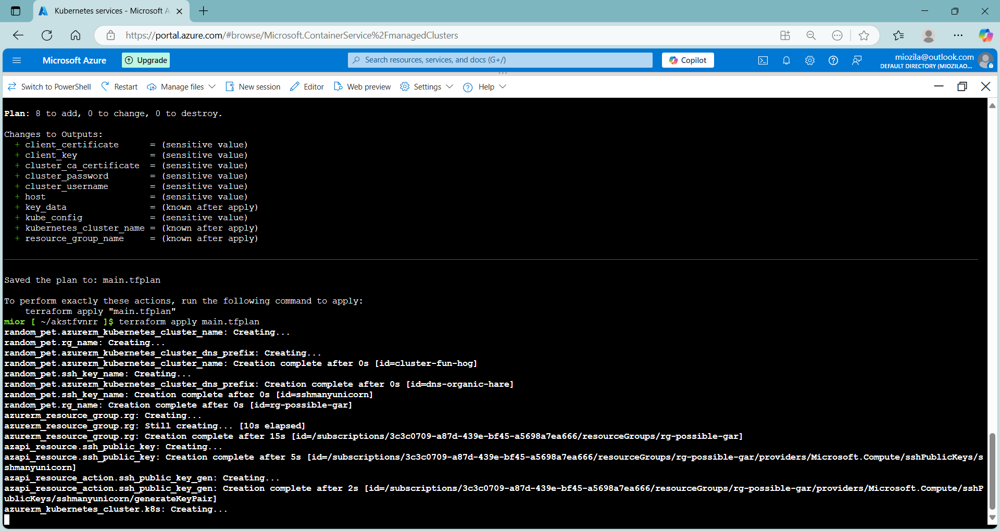

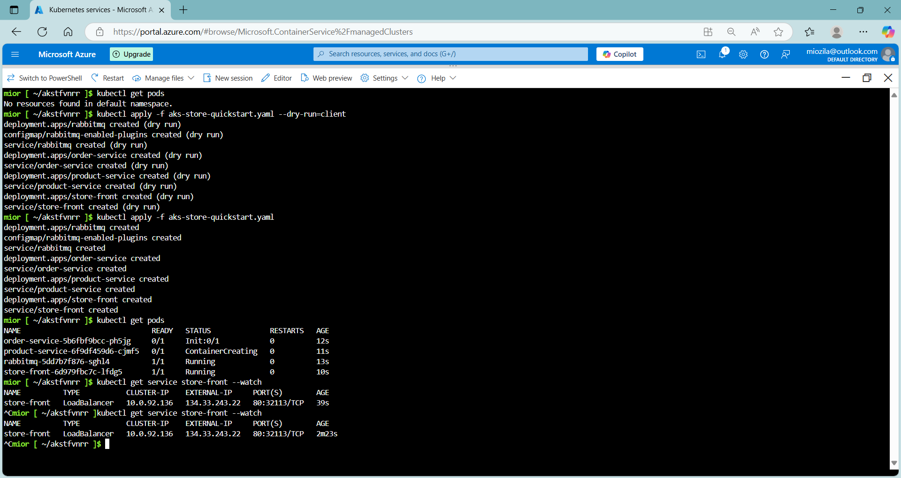

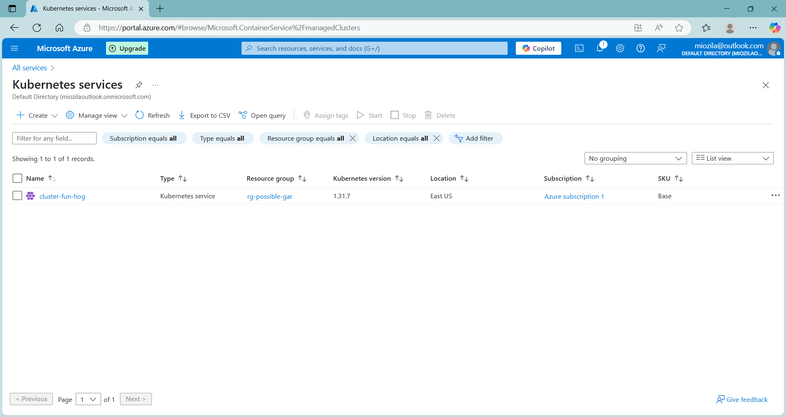

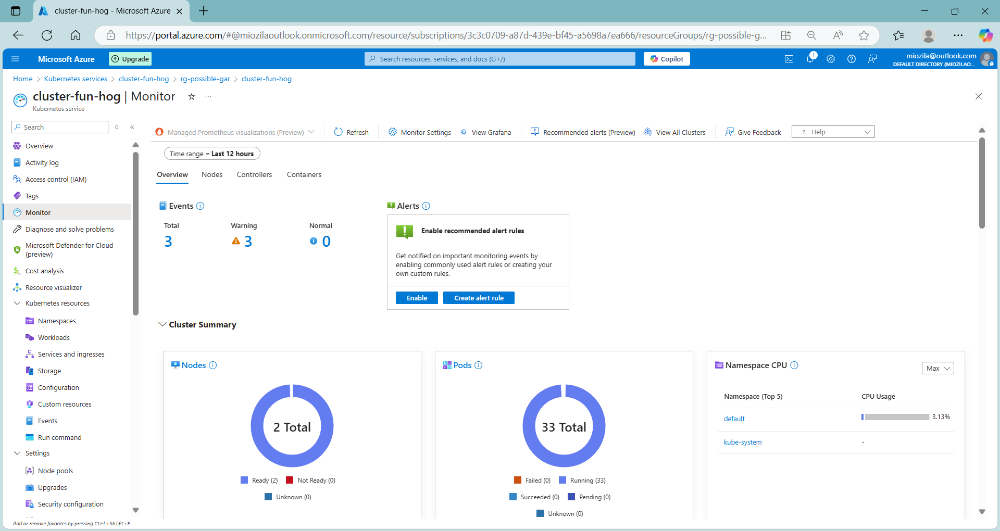

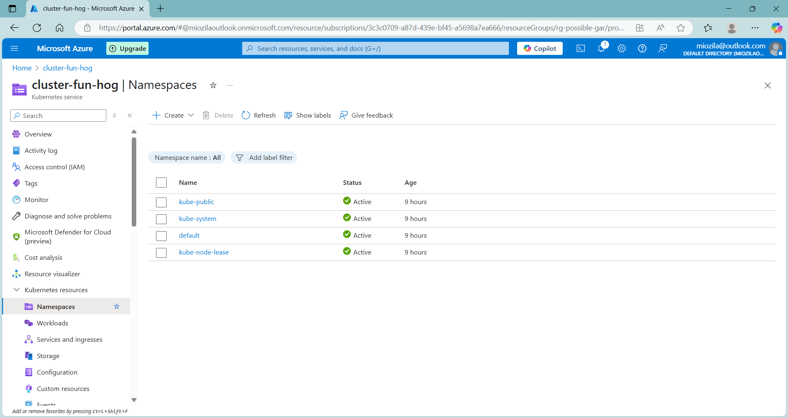

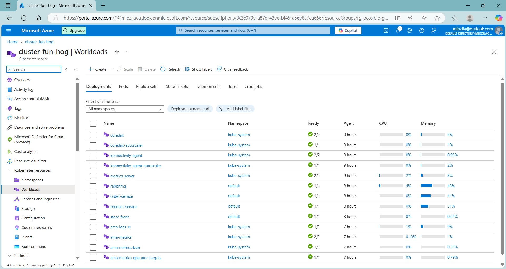

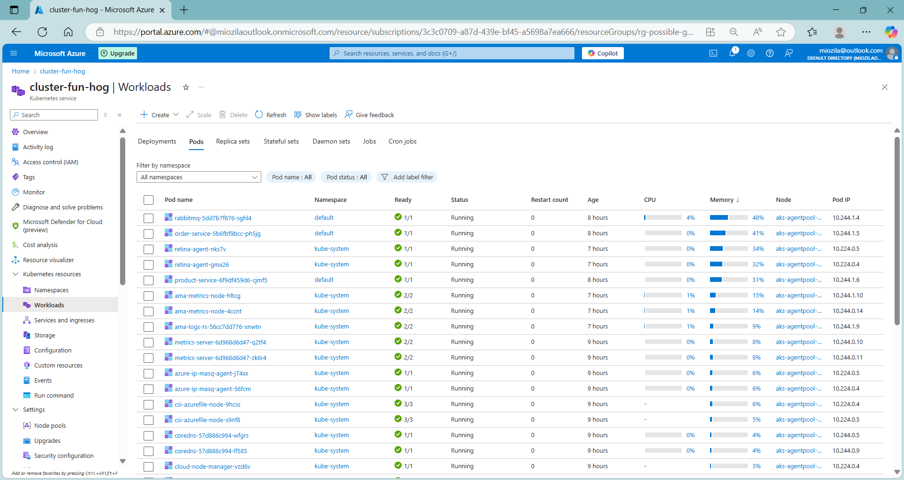

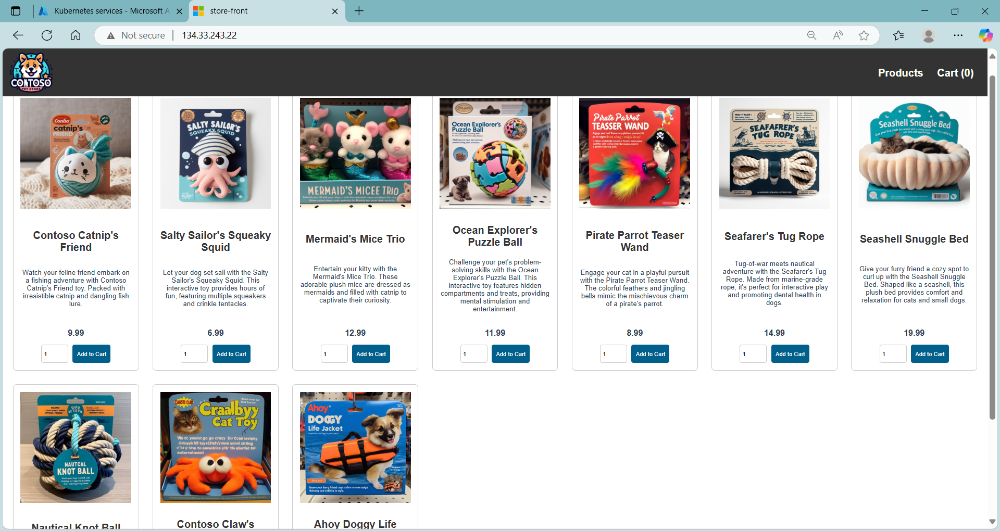

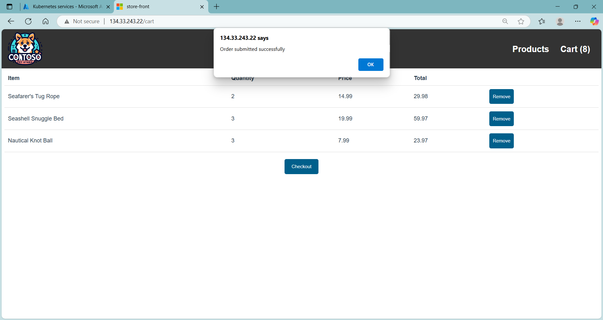

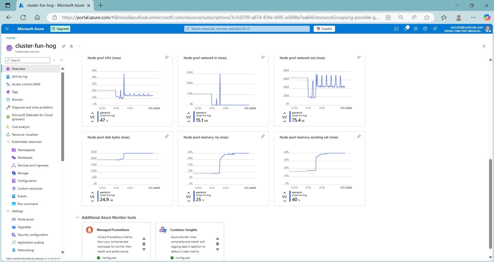

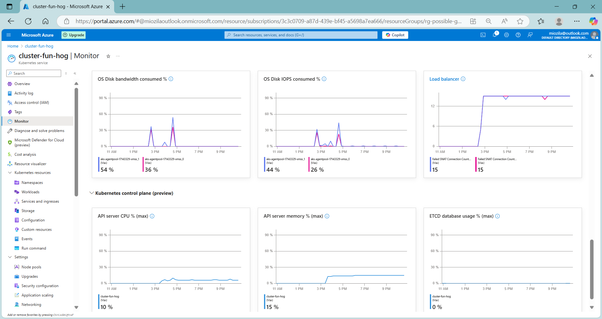

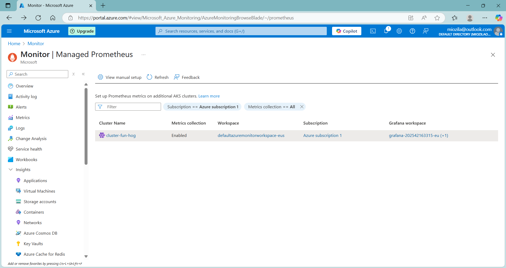

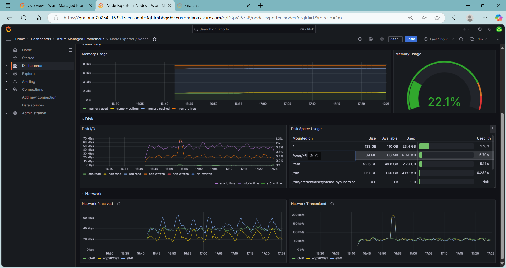

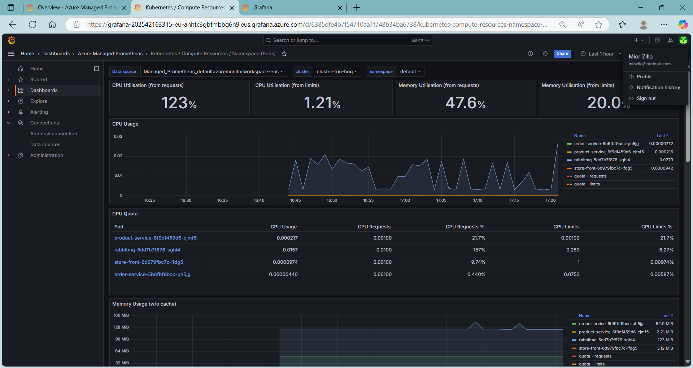

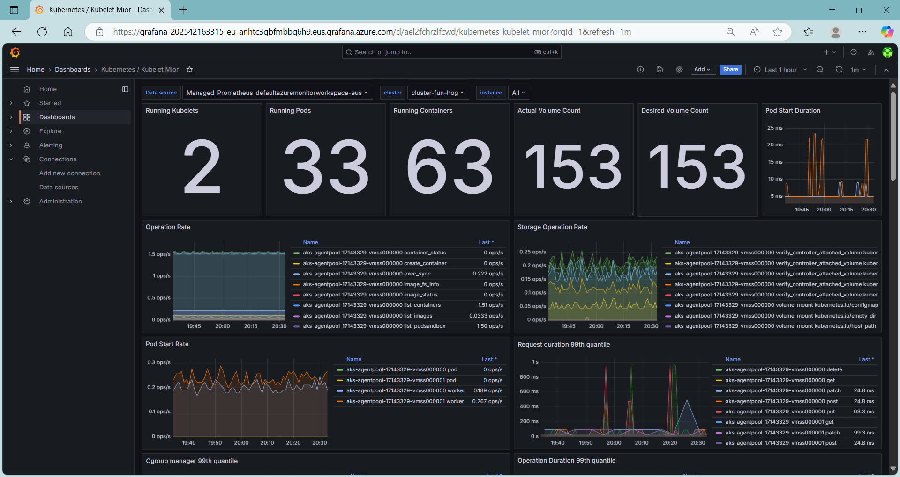
